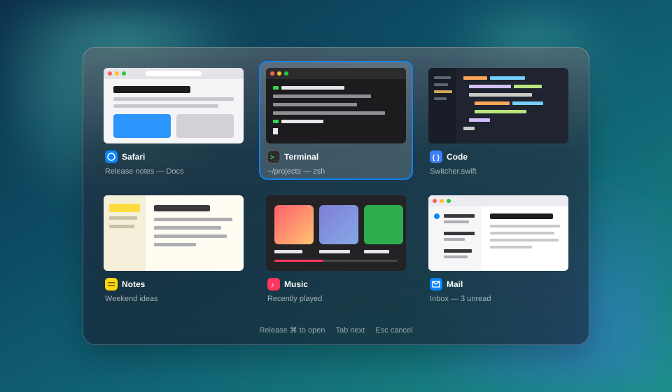

<div align="center">

# Tab Switch

**⌘Tab for windows, not apps, with live previews.**

A tiny macOS menu bar app that replaces the system switcher with a grid of every window on your screen, so you can see where you're going before you get there.




<sub>Illustration of the panel. Real previews are live captures of your windows.</sub>

</div>

## Why

The built-in ⌘Tab switches between **apps**. Got three browser windows and two terminals? ⌘Tab won't tell you which is which, and you end up cycling through them one by one.

Tab Switch shows each **window** on its own, with a live thumbnail, the app icon and the window title. Hold ⌘, tap Tab, let go, and you're there.

It's deliberately simple: one menu bar icon, one panel, no settings screen, no dependencies, about a thousand lines of Swift.

## Features

- 🪟 **Every window, not every app.** All windows on the current Space, each with its own preview.
- ⚡️ **Instant.** The panel opens right away. Previews arrive in about a second and are cached for next time.
- ⌨️ **Works like the real thing.** Same muscle memory as the system switcher, so there's nothing new to learn.
- 💧 **Liquid Glass.** A see-through glass panel on macOS 26, with a regular blur on older versions.
- 🔒 **Private.** Thumbnails are kept in memory only, never written to disk, never sent anywhere.
- 🧹 **Leaves no trace.** The system ⌘Tab is turned off only while the app runs and comes back when you quit.

## Shortcuts

| Keys | Action |
| --- | --- |
| **⌘Tab** / **⌥Tab** | Open the switcher |
| **Tab** / **⇧Tab** or arrow keys | Move the selection (keep holding the modifier) |
| Release **⌘** / **⌥** | Switch to the selected window |
| **Return** or click | Switch to the selected window |
| **Esc** | Close and stay where you were |

## Install

Tab Switch is built from source. It takes about a minute.

**You'll need:** macOS 14 or later, Apple Silicon and the Xcode Command Line Tools (`xcode-select --install`).

```bash
git clone https://github.com/andreyfrolovwork/tab_switch.git
cd tab_switch
./build.sh
open dist/WindowSwitcher.app
```

No Xcode project and no package manager. `build.sh` calls `swiftc` directly. Copy `dist/WindowSwitcher.app` to `/Applications` if you want to keep it. To start it with your Mac, add it in **System Settings → General → Login Items**.

## Permissions

On first launch, and on every launch after that until both are granted, Tab Switch tells you what's missing and opens the right page in **System Settings → Privacy & Security**:

| Permission | What it's for | Without it |
| --- | --- | --- |
| **Accessibility** | Catching ⌘Tab and bringing the chosen window forward | The system ⌘Tab stays as it was |
| **Screen & System Audio Recording** | Capturing window thumbnails | The switcher works, just without previews |

In System Settings the app is listed as **Tab Switch**. If it doesn't show up under Screen Recording, add it with the **+** button and pick `WindowSwitcher.app`.

<details>
<summary><b>Keep permissions across rebuilds</b></summary>

<br>

macOS ties permissions to the app's code signature. With an ad-hoc signature every build counts as a new app, and you'd have to grant everything again.

Create a self-signed certificate once:

1. Open **Keychain Access → Certificate Assistant → Create a Certificate…**
2. Name: `WindowSwitcher Local`, Identity Type: **Self Signed Root**, Certificate Type: **Code Signing**.

`build.sh` picks it up automatically and falls back to ad-hoc signing when it can't find it.

</details>

## How it works

| File | Role |
| --- | --- |
| [`KeyMonitor.swift`](Sources/KeyMonitor.swift) | `CGEventTap` that catches ⌘Tab / ⌥Tab and the navigation keys |
| [`SystemHotkeys.swift`](Sources/SystemHotkeys.swift) | Turns the system ⌘Tab and ⇧⌘Tab off while the tap is active and back on at exit, including on `SIGTERM` |
| [`Windows.swift`](Sources/Windows.swift) | Lists windows via `CGWindowList` and raises the chosen one via the Accessibility API |
| [`Thumbnails.swift`](Sources/Thumbnails.swift) | Captures previews with ScreenCaptureKit |
| [`Switcher.swift`](Sources/Switcher.swift), [`SwitcherView.swift`](Sources/SwitcherView.swift) | The glass panel and its grid |
| [`main.swift`](Sources/main.swift) | Menu bar item, permission checks, startup |

> [!NOTE]
> Quit from the menu bar or with `kill -TERM`. A hard `kill -9` skips the cleanup, so the system ⌘Tab stays off until you start Tab Switch and quit it again.

<details>
<summary><b>Debugging</b></summary>

<br>

```bash
# List the windows Tab Switch can see
dist/WindowSwitcher.app/Contents/MacOS/WindowSwitcher --dump

# Capture thumbnails with the app's own Screen Recording permission and print their sizes
open -n -W --stdout /dev/stdout dist/WindowSwitcher.app --args --thumbs
```

The running app logs its state (`hotkey on`, `capture on`, `needs access`, …) to `/tmp/windowswitcher.log`.

</details>

## Limitations

- Shows windows on the current Space only.
- Apple Silicon only for now (`build.sh` targets `arm64`).
- No prebuilt release yet, so you build it yourself.

## License

[MIT](LICENSE)
